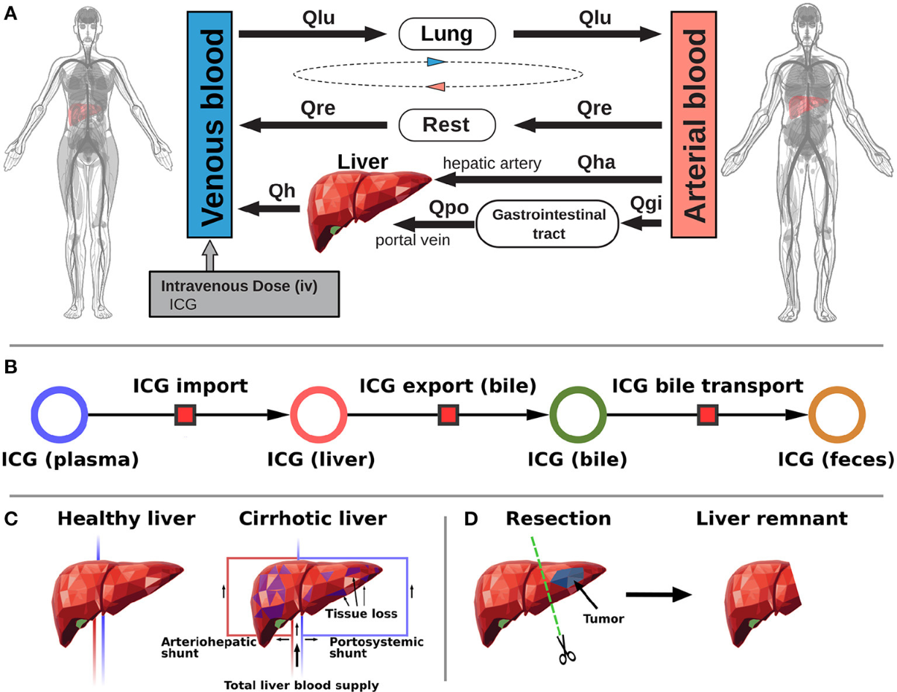
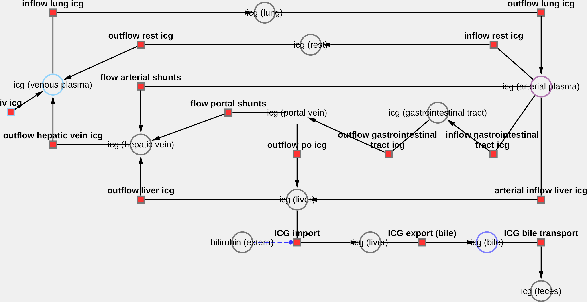
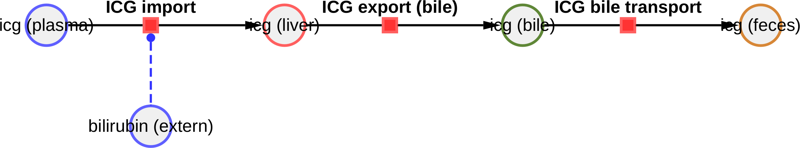

# ICG model
This repository provides the indocyanine (ICG) green physiological based pharmacokinetics model (PBPK) described in

> Prediction of survival after partial hepatectomy using a physiologically based pharmacokinetic model of indocyanine green liver function tests
*Adrian Köller, Jan Grzegorzewski, Hans-Michael Tautenhahn, Matthias König*  
Front. Physiol., 22 November 2021 (publication). doi:[10.3389/fphys.2021.730418](https://doi.org/10.3389/fphys.2021.730418).

The model is distributed as [SBML](http://sbml.org) available from [`icg_body_flat.xml`](./models/icg_body_flat.xml) with 
corresponding SBML4humans model report at [https://sbml4humans.de/model_url?url=https://raw.githubusercontent.com/matthiaskoenig/icg-model/main/models/icg_body_flat.xml](https://sbml4humans.de/model_url?url=https://raw.githubusercontent.com/matthiaskoenig/icg-model/main/models/icg_body_flat.xml) 

### Comp submodels
The liver submodel is available from [`icg_liver.xml`](./models/icg_liver.xml) with corresponding SBML4humans report at
[https://sbml4humans.de/model_url?url=https://raw.githubusercontent.com/matthiaskoenig/icg-model/main/models/icg_liver.xml](https://sbml4humans.de/model_url?url=https://raw.githubusercontent.com/matthiaskoenig/icg-model/main/models/icg_liver.xml)

The whole-body submodel is available from [`icg_body.xml`](./models/icg_body.xml) with corresponding SBML4humans report at
[https://sbml4humans.de/model_url?url=https://raw.githubusercontent.com/matthiaskoenig/icg-model/main/models/icg_body.xml](https://sbml4humans.de/model_url?url=https://raw.githubusercontent.com/matthiaskoenig/icg-model/main/models/icg_body.xml)

## How to cite

> Prediction of survival after partial hepatectomy using a physiologically based pharmacokinetic model of indocyanine green liver function tests
*Adrian Köller, Jan Grzegorzewski, Hans-Michael Tautenhahn, Matthias König*  
Front. Physiol., 22 November 2021 (publication). doi:[10.3389/fphys.2021.730418](https://doi.org/10.3389/fphys.2021.730418).

Additional applications of the model can be found in

> Physiologically based modeling of the effect of physiological and anthropometric variability on indocyanine green based liver function tests  
*Adrian Köller, Jan Grzegorzewski and Matthias König*
Front Physiol. 2021 Nov 22;12:757293 (publication). doi:[10.3389/fphys.2021.757293](https://doi.org/10.3389/fphys.2021.757293).

## License

* Source Code: [MIT](https://opensource.org/license/MIT)
* Documentation: [CC BY-SA 4.0](http://creativecommons.org/licenses/by-sa/4.0/)
* Models: [CC BY-SA 4.0](http://creativecommons.org/licenses/by-sa/4.0/)

This program is distributed in the hope that it will be useful, but WITHOUT ANY
WARRANTY; without even the implied warranty of MERCHANTABILITY or FITNESS FOR A
PARTICULAR PURPOSE.

## Funding

Adrian Köller and Matthias König were supported by the Federal Ministry of Education and Research (BMBF, Germany)
within the research network Systems Medicine of the Liver (LiSyM, grant number 031L0054). 
Matthias König was supported by the Federal Ministry of Research, Technology and Space (BMFTR, Germany) within ATLAS by grant number 031L0304B and by the German Research Foundation (DFG) within the Research Unit Program FOR 5151 QuaLiPerF (Quantifying Liver Perfusion-Function Relationship in Complex Resection - A Systems Medicine Approach) by grant number 436883643 and by grant number 465194077 (Priority Programme SPP 2311, Subproject SimLivA). This work was supported by the BMBF-funded de.NBI Cloud within the German Network for Bioinformatics Infrastructure (de.NBI) (031A537B, 031A533A, 031A538A, 031A533B, 031A535A, 031A537C, 031A534A, 031A532B). 

© 2020-2026 [Matthias König](https://livermetabolism.com)
