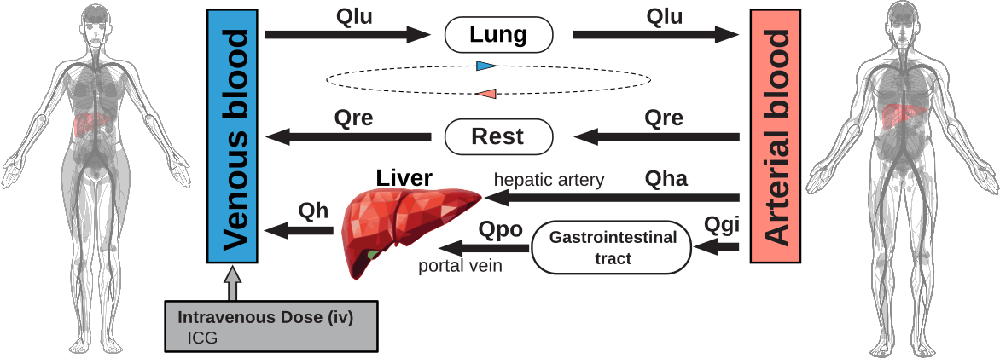
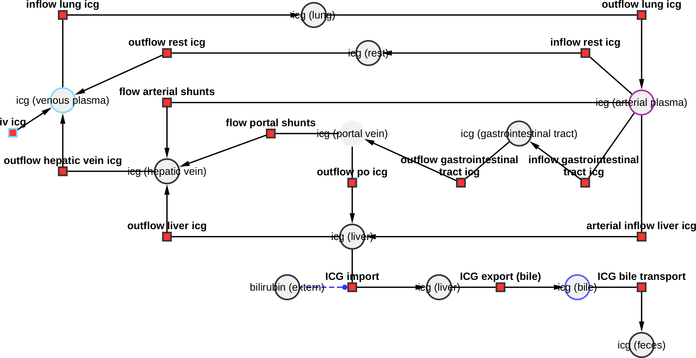

# Models

The models are distributed in [SBML](http://sbml.org) format.

## icg_body

* Model: [`icg_body.xml`](https://raw.githubusercontent.com/matthiaskoenig/icg-model/main/models/icg_body.xml)
* Equations: [`icg_body.md`](https://github.com/matthiaskoenig/icg-model/blob/main/models/icg_body.md)
* Report: [SBML4humans](https://sbml4humans.de/report?url=https%3A%2F%2Fraw.githubusercontent.com%2Fmatthiaskoenig%2Ficg-model%2Fmain%2Fmodels%2Ficg_body.xml)

{ style="max-height: 420px; width: auto; max-width: 100%" }

## icg_body_flat

* Model: [`icg_body_flat.xml`](https://raw.githubusercontent.com/matthiaskoenig/icg-model/main/models/icg_body_flat.xml)
* Equations: [`icg_body_flat.md`](https://github.com/matthiaskoenig/icg-model/blob/main/models/icg_body_flat.md)
* Report: [SBML4humans](https://sbml4humans.de/report?url=https%3A%2F%2Fraw.githubusercontent.com%2Fmatthiaskoenig%2Ficg-model%2Fmain%2Fmodels%2Ficg_body_flat.xml)

{ style="max-height: 420px; width: auto; max-width: 100%" }

## icg_liver

* Model: [`icg_liver.xml`](https://raw.githubusercontent.com/matthiaskoenig/icg-model/main/models/icg_liver.xml)
* Equations: [`icg_liver.md`](https://github.com/matthiaskoenig/icg-model/blob/main/models/icg_liver.md)
* Report: [SBML4humans](https://sbml4humans.de/report?url=https%3A%2F%2Fraw.githubusercontent.com%2Fmatthiaskoenig%2Ficg-model%2Fmain%2Fmodels%2Ficg_liver.xml)

{ style="max-height: 420px; width: auto; max-width: 100%" }

## COMBINE archive

The models and the metadata are available as COMBINE archive from [`icg_model.omex`](https://raw.githubusercontent.com/matthiaskoenig/icg-model/main/icg_model.omex).
